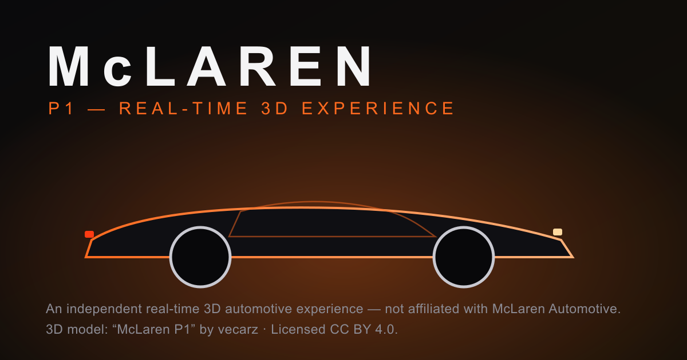

# McLaren P1 — Real-Time 3D Experience

An independent, real-time WebGL automotive experience built as a portfolio piece.
The McLaren P1 is rendered live in the browser with **React Three Fiber** — a
cinematic, scroll-bound camera rig, a baked lightformer studio, and a fully
interactive vehicle configurator with real-time material swaps.

> **Not affiliated with, endorsed by, or sponsored by McLaren Automotive.**
> “McLaren” and “P1” are trademarks of McLaren Automotive and are used only to
> identify the subject of an editorial study. See
> [`NOTICE.md`](./NOTICE.md) for the full licensing & provenance disclosure.

**Live demo:** <https://mclaren-p1-experience.vercel.app/>



## Features

- **Cinematic WebGL hero** — a scroll-bound camera that flies through the car,
  driven by Framer Motion and a custom keyframe rig, with mouse parallax.
- **Authentic McLaren P1 model** — a web-optimised GLB by vecarz (**CC-BY 4.0**),
  with real clearcoat paint, glass, interior, wheels and an emissive light
  signature (2.3 MB).
- **Custom lightformer studio** — PBR clearcoat paint lit by a baked
  `<Lightformer>` environment (no external HDRI download).
- **Scroll storytelling** — an original SVG aerodynamic blueprint with live
  airflow streamlines that re-highlight per feature.
- **Live configurator** — orbit-able 3D with real-time paint / wheel / caliper /
  aero selection, material lerping and a running price total.
- **Production hardening** — reduced-motion support, mobile / low-power
  fallbacks, accessible nav & focus states, SEO metadata + Open Graph + JSON-LD,
  a full icon/manifest set, sitemap, robots.txt and Vercel security headers
  (CSP, HSTS, X-Frame-Options, …).

## Tech stack

React 19 · Vite · Tailwind CSS v4 · React Three Fiber · drei · three ·
Framer Motion · lucide-react.

## Quick start

Requires **Node 18+**.

```bash
npm install
npm run dev        # http://localhost:5173
```

| Script            | Purpose                              |
| ----------------- | ------------------------------------ |
| `npm run dev`     | Start the Vite dev server            |
| `npm run build`   | Production build to `dist/`          |
| `npm run preview` | Preview the production build locally |
| `npm run lint`    | ESLint over the project              |

## Architecture

```
src/
  three/         # ConceptCar.jsx (P1 loader/materials), StudioEnvironment.jsx, HeroScene.jsx
  components/    # Preloader, Nav, Hero, Performance, AeroStory, Manifesto, Configurator, Footer
  lib/hooks.js   # reduced-motion + device-capability hooks
  assets/content.js  # copy, specs and configurator data (single source of truth)
public/
  mclaren-p1.glb # the licensed 3D model
  favicon.* / icon-*.png / apple-touch-icon.png / site.webmanifest  # icon set (favicon.svg is the source)
  og.svg → og.png # social preview (og.png is generated from og.svg)
```

## Deployment

The site is a static Vite SPA. On Vercel it uses the **Vite** framework preset
(build `npm run build`, output `dist`); the project auto-deploys from `main`.
All security headers, the Content-Security-Policy and per-asset caching rules
live in [`vercel.json`](./vercel.json). Any static host that can send custom
response headers works the same way.

## Credits

- Design, engineering & copy: **Lakhya Jit** — lakhya.support@gmail.com
- 3D model: **“Mclaren P1 | www.vecarz.com”** by
  [vecarz](https://sketchfab.com/3d-models/mclaren-p1-wwwvecarzcom-adae2edc721e4ce7b31c1d06a581e30a),
  licensed **CC-BY 4.0** via Sketchfab (credited in the site footer).
- Fonts: Space Grotesk (SIL OFL 1.1), Inter (SIL OFL 1.1).
- Open-source libraries under their own MIT/ISC licenses (see
  [`NOTICE.md`](./NOTICE.md)).

## License

Original source code © 2026 Lakhya Jit — [MIT](./LICENSE). The 3D model asset is
**CC-BY 4.0** (vecarz) and is **not** relicensed by the MIT grant. This project
grants no rights in any third-party trademarks or vehicle designs. See
[`NOTICE.md`](./NOTICE.md).
