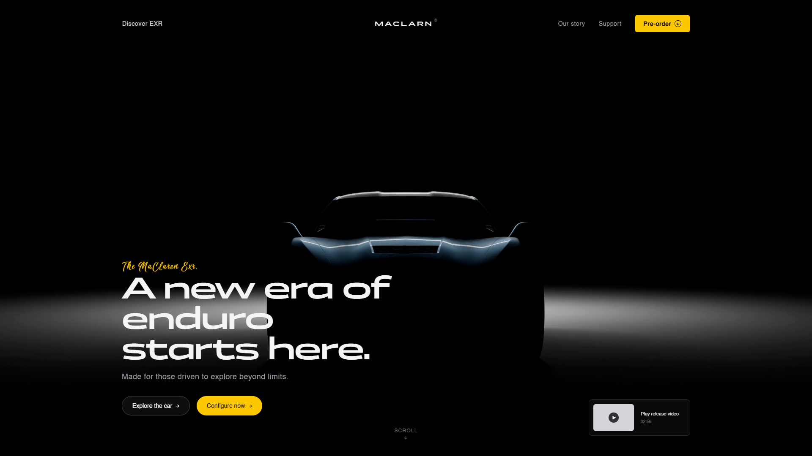
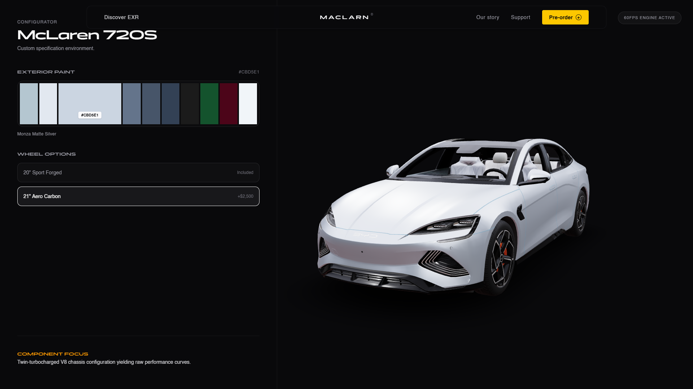
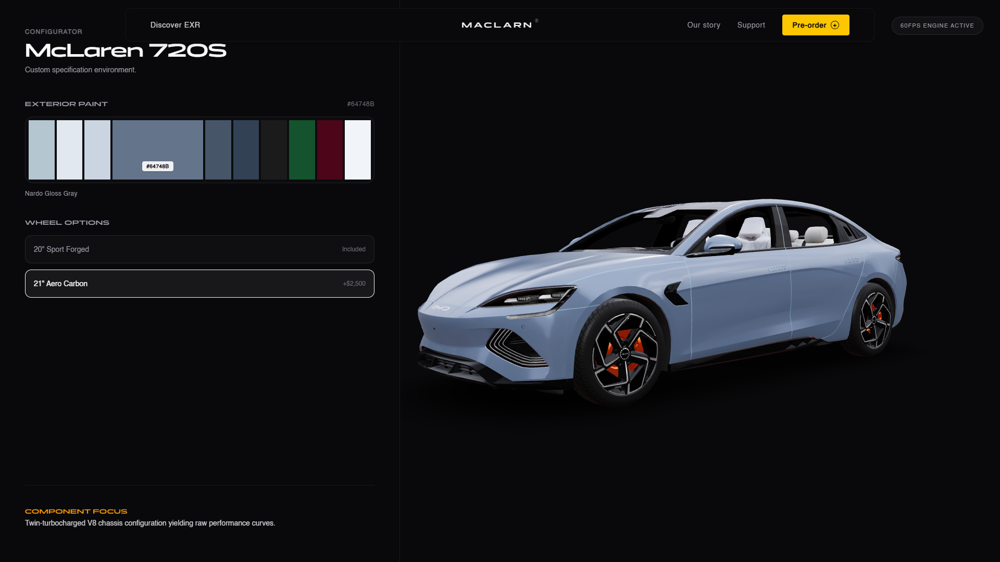
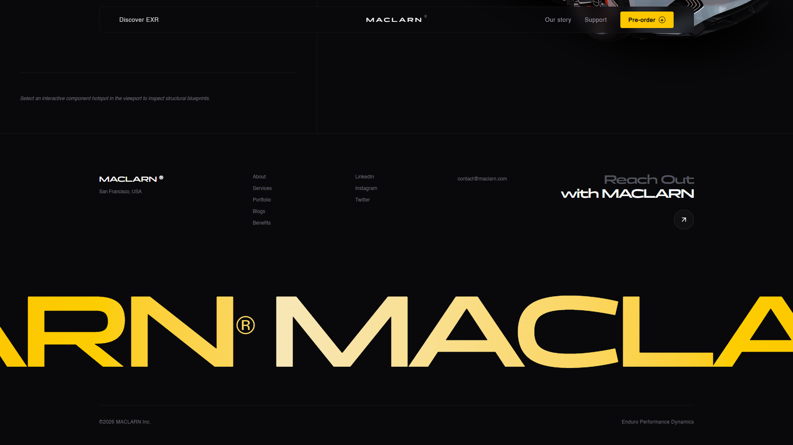

# Aesthetic Website Designs

A small, opinionated front-end project demonstrating clean, modern web aesthetics and interactive UI patterns. Browse the demo to learn practical visual techniques: sticky sections, scroll-driven sequences, layered imagery, and a lightweight vehicle configurator.

Features
- **Playful visuals:** layered hero and frame compositions for depth.
- **Interactive UI:** sticky scroll, scroll sequences, and responsive configurator.
- **Learning-focused:** clear components to study and reuse in your own projects.

Showcase

Here are a few snapshots from the website:

### Hero section


### Configurator


### Configurator 


### Footer section


Quick start

1. Install dependencies:

```
npm install
```

2. Run the dev server:

```
npm run dev
```

Contributions welcome — open issues or PRs with any aesthetic tweaks or small component improvements.

