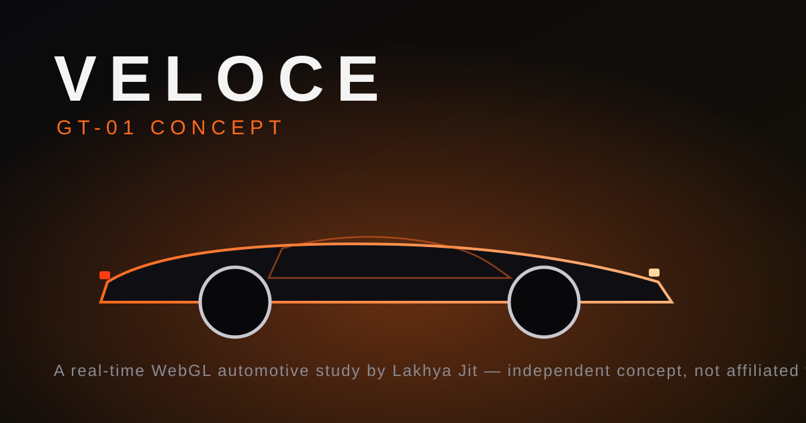

# McLaren P1 — Real-Time 3D Study

> An independent, real-time WebGL automotive study built as a portfolio piece.
> **Not affiliated with or endorsed by McLaren Automotive.** See
> [`NOTICE.md`](./NOTICE.md) for the full licensing & provenance disclosure.

A cinematic landing page for the McLaren P1, rendered live in the browser with
**React Three Fiber**. The vehicle is an authentic community model
([vecarz](https://sketchfab.com/heynic), **CC-BY 4.0**, see credits) optimised
for the web (2.3 MB GLB), driven by a scroll-bound camera rig and a live
materials configurator.



## What's here

- **Cinematic WebGL hero** — a scroll-bound camera that flies through the car,
  driven by Framer Motion and a custom keyframe rig, with mouse parallax.
- **Authentic McLaren P1 model** — 203k-tri GLB by vecarz (CC-BY 4.0),
  re-encoded for the web (meshopt + WebP, 2.3 MB); real clearcoat paint,
  glass, interior, wheels and an emissive light signature.
- **Custom lightformer studio** — PBR clearcoat paint lit by a baked `<Lightformer>`
  environment (no external HDRI download).
- **Scroll storytelling** — an animated, original SVG aerodynamic blueprint with
  live airflow streamlines that re-highlights per feature.
- **Live configurator** — orbit-able 3D with real-time paint / wheel / caliper /
  aero selection, material lerping and running price total.
- **Production hardening** — reduced-motion support, mobile/low-power fallbacks,
  accessible nav & focus states, SEO metadata + Open Graph + JSON-LD, sitemap,
  robots.txt and Vercel security headers (CSP, HSTS, X-Frame-Options, …).

## Tech stack

React 19 · Vite · Tailwind CSS v4 · React Three Fiber · drei · three · Framer Motion · lucide-react.

## Quick start

```bash
npm install
npm run dev      # http://localhost:5173
npm run lint     # eslint
npm run build    # production build to dist/
npm run preview  # preview the production build
```

## Structure

```
src/
  three/         # ConceptCar.jsx (P1 loader/materials), StudioEnvironment.jsx, HeroScene.jsx
  components/    # Preloader, Nav, Hero, Performance, AeroStory, Manifesto, Configurator, Footer
  lib/hooks.js   # reduced-motion + device-capability hooks
  assets/content.js  # copy, specs, configurator data
```

## Credits

- Design, engineering & copy: **Lakhya Jit** — lakhya.support@gmail.com
- 3D model: **“Mclaren P1 | www.vecarz.com”** by [vecarz](https://sketchfab.com/heynic),
  licensed **CC-BY 4.0** via Sketchfab (credited in the site footer)
- Font: Space Grotesk (SIL OFL 1.1), Inter (SIL OFL 1.1)
- Open-source libraries under their own MIT/ISC licenses (see NOTICE.md)

## License

Original source code © 2026 Lakhya Jit — [MIT](./LICENSE). The 3D model asset is
CC-BY 4.0 (vecarz). This license does not cover any third-party trademarks or
vehicle designs. See [NOTICE.md](./NOTICE.md).
